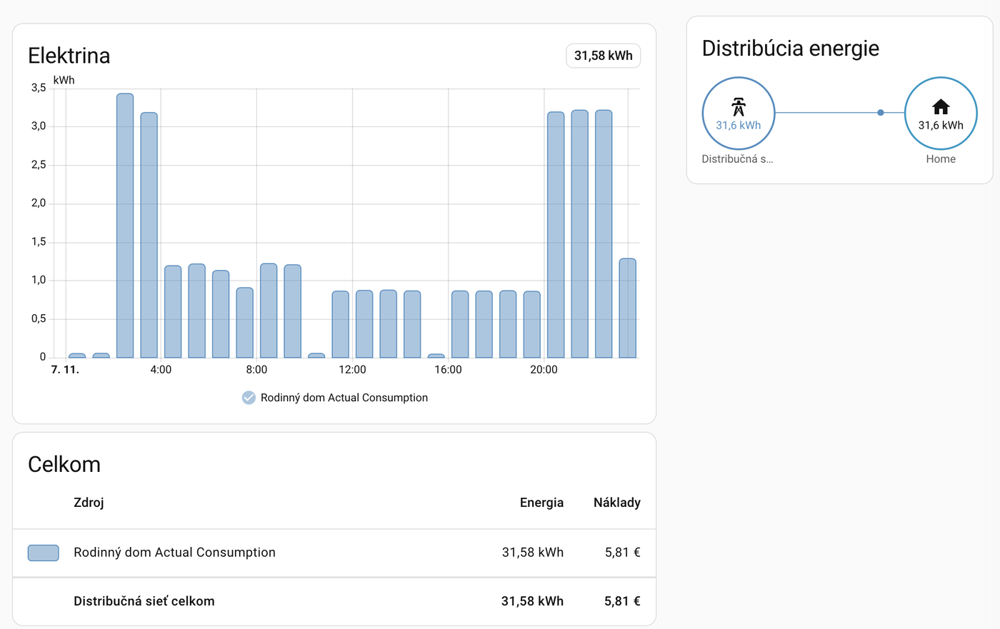

# Home Assistant Integration for Stredoslovenská distribučná (SSD IMS)

A custom HA integration for gathering energy consumption and supply data from the Portál energetických dát <https://ims.ssd.sk> with automatic import into Home Assistant's long-term statistics for use in the Energy dashboard.



## Features

- **Energy Statistics Import**: Automatically imports historical and daily energy data into Home Assistant's statistics database
- **Energy Dashboard Ready**: Data is formatted for direct use in Home Assistant's Energy dashboard
- **Tariff Register Readings (VT/NT)**: Imports the meter's monthly high/low tariff register readings and peak demand, with optional cost statistics computed from your tariff prices
- **Multiple POD Support**: Monitor multiple Points of Delivery simultaneously
- **Custom POD Names**: Set friendly names for your Points of Delivery (e.g., home address, apartment name)
- **Historical Data Import**: Import past energy data during initial setup (configurable, up to 365 days)
- **Automatic Updates**: Configurable update interval (6, 12, or 24 hours recommended)
- **Re-authentication Flow**: When credentials expire, Home Assistant prompts you to re-enter them without removing the integration
- **Reconfigure Flow**: Update your Points of Delivery selection and names at any time via the "Reconfigure" option
- **Diagnostics Support**: Download integration diagnostics (credentials automatically redacted) to help with troubleshooting
- **Robust Error Handling**: Comprehensive error handling with automatic re-authentication

## Data Characteristics

**Data Freshness**: The Portál energetických dát provides day-old data that is published after midnight:

- Data for the current day is not available
- The most recent data available is from yesterday
- Data is updated once daily after midnight

**Data Resolution**: All metering data has 15-minute resolution from the source, aggregated to hourly statistics for Home Assistant.

**Tariff Registers**: The meter's tariff registers (1.8.1 = VT/high tariff, 1.8.2 = NT/low tariff, 1.6.0 = peak demand) come from the portal's *Registrové údaje* page. They are cumulative counters read **once a month** (00:00 on the 1st, plus occasional ad-hoc readings), so the VT/NT split is only available per month — the 15-minute profile has no tariff split, and the portal doesn't publish HDO switching times.

## Sensors Created

The integration creates **8 sensors per Point of Delivery**:

| Sensor | Description |
|--------|-------------|
| `sensor.<pod_name>_actual_consumption_yesterday` | Yesterday's total energy consumption (kWh) |
| `sensor.<pod_name>_actual_supply_yesterday` | Yesterday's total energy supply/production (kWh) |
| `sensor.<pod_name>_actual_consumption_total` | Cumulative total consumption from statistics (kWh) |
| `sensor.<pod_name>_actual_supply_total` | Cumulative total supply from statistics (kWh) |
| `sensor.<pod_name>_last_update` | Timestamp of last data update |
| `sensor.<pod_name>_high_tariff_meter_reading` | Latest monthly VT register reading, 1.8.1 (kWh, cumulative counter) |
| `sensor.<pod_name>_low_tariff_meter_reading` | Latest monthly NT register reading, 1.8.2 (kWh, cumulative counter) |
| `sensor.<pod_name>_peak_demand` | Peak quarter-hour demand of the latest reading period, 1.6.0 (kW) |

The register sensors have `reading_time` and `meter_serial_number` attributes.

## Long-Term Statistics

The integration imports energy data into Home Assistant's statistics database with hourly granularity:

| Statistic ID | Description |
|--------------|-------------|
| `ssd_ims:<pod_name>_actual_consumption` | Cumulative energy consumption (kWh) |
| `ssd_ims:<pod_name>_actual_supply` | Cumulative energy supply/production (kWh) |
| `ssd_ims:<pod_name>_consumption_vt` | High tariff (VT) consumption, monthly (kWh) |
| `ssd_ims:<pod_name>_consumption_nt` | Low tariff (NT) consumption, monthly (kWh) |
| `ssd_ims:<pod_name>_cost_vt` | High tariff cost, monthly (EUR) — only when a VT price is set |
| `ssd_ims:<pod_name>_cost_nt` | Low tariff cost, monthly (EUR) — only when an NT price is set |
| `ssd_ims:<pod_name>_actual_consumption_cost` | Hourly cost of `actual_consumption` (EUR) — only when a VT price is set (NT defaults to the VT price) |

The VT/NT statistics are the differences between consecutive register readings. Each month's value is placed in the last hour of that month (a reading at 00:00 on 1 December closes November), so the Energy dashboard's month and year views show the correct split, while day/hour views show it as a single block at the end of the month. On first setup the full register history available on the portal is imported (back to the meter's installation); the first reading only serves as the baseline. No difference is computed across a meter replacement.

`<pod_name>` is derived from the friendly name you assign the POD during setup. **Renaming a POD later (via Reconfigure) changes its statistic ID and starts a new series** — the previous history isn't carried over. Pick a name you're happy to keep, or expect to reconfigure the Energy dashboard source if you rename it.

These statistics can be used directly in the Energy dashboard configuration.

## Installation

### Method 1: Marketplace (Recommended, Home Assistant 2026.11+)

Since Home Assistant 2026.11, HACS is built in as the **Marketplace**.

1. Go to **Settings** → **Marketplace** (the first time, accept the warning shown there)
2. Search for "Stredoslovenská distribučná (SSD IMS)" and open it
3. Select **Install**, check the version and select **Install** again
4. The setup opens right away; if Home Assistant needs a restart first, a Repairs entry offers it

If you installed the integration with HACS before 2026.11, there's nothing to do: on the first start after the update the Marketplace takes over from HACS, and the integration stays installed and keeps getting updates (under **Settings** → **Updates**).

### Method 2: HACS (Home Assistant before 2026.11)

1. Open HACS in Home Assistant
2. Click on "Integrations"
3. Click the "+" button
4. Search for "Stredoslovenská distribučná (SSD IMS)"
5. Click "Install"
6. Restart Home Assistant

### Method 3: Manual Installation

1. Download this repository
2. Copy the `custom_components/ssd_ims` folder to your Home Assistant `config/custom_components/` directory
3. Restart Home Assistant
4. Add the integration via the UI

### Upgrading to 2.3.0

The update needs no action and keeps all existing statistics, sensors and settings. After the restart the integration adds the tariff register sensors and imports the `consumption_vt` / `consumption_nt` statistics with the full register history on its own.

To see costs in the Energy dashboard:

1. Enter your tariff prices in the integration's options (see [Options Flow](#options-flow)) — VT only for single-rate tariffs (D1/D2).
2. In the Energy dashboard settings, edit the grid consumption `ssd_ims:<pod_name>_actual_consumption` and choose **Use an entity tracking the total costs** → `ssd_ims:<pod_name>_actual_consumption_cost`. The costs for all imported consumption are computed within a minute of saving the prices.

Keep in mind:

- **Don't also add the VT/NT statistics** to the Energy dashboard — they measure the same energy as `actual_consumption`, so it would be counted twice (see [Costs](#costs)).
- **All history is priced at the current price.** Earlier years had different prices, so older costs are only an approximation.

## Configuration

### Setup Flow

1. Go to **Settings** → **Devices & Services**
2. Click **Add Integration**
3. Search for "Stredoslovenská distribučná (SSD IMS)"
4. **Step 1 - Credentials**: Enter your SSD IMS portal credentials (<https://ims.ssd.sk>)
5. **Step 2 - POD Selection**: Select which Points of Delivery to monitor
6. **Step 3 - POD Names**: Set friendly names for your PODs (optional, e.g., your home address)
7. **Step 4 - Data Import & Refresh**: Configure update interval and historical data import

### Configuration Options

| Option | Default | Description |
|--------|---------|-------------|
| Update Interval | 6 hours | How often to check for new data (6h, 12h, or 24h recommended) |
| Enable History Import | Yes | Import historical energy data on first setup |
| Days to Import | 7 | Number of days of historical data to import (1-365) |

### Options Flow

After setup, you can change these via **Settings** → **Devices & Services** → **Stredoslovenská distribučná (SSD IMS)** → **Configure**:

| Option | Description |
|--------|-------------|
| Update Interval | How often to check for new data |
| High tariff (VT) price | Optional. Final price in EUR per kWh incl. VAT and all per-kWh fees — enables the hourly `actual_consumption_cost` and the monthly `cost_vt` statistics |
| Low tariff (NT) price | Optional. Same for NT — enables the monthly `cost_nt` statistic. Leave empty for single-rate tariffs (D1/D2): the VT price is then used for all consumption |

Your supplier invoice usually lists these final prices (e.g. SSE prints them as *Aktuálne koncové ceny elektriny platné pre Vašu sadzbu*). Use those rather than adding up the invoice's line items yourself — the final price already contains supply, distribution, losses and the per-kWh regulated fees (system operation TPS, system services TSS, nuclear fund levy NJF) plus VAT, which are easy to leave out of a manual sum. Fixed monthly fees (supplier fee, distribution fee by breaker size) can't be represented in the Energy dashboard and are not included. Saving the options applies the prices right away. The first import prices all history at the current price. After a price change, the monthly `cost_vt` / `cost_nt` keep the old price for months already imported, while the hourly `actual_consumption_cost` is recalculated with the new price for the last three register periods (roughly the last two months plus the current one); older hours keep the old price.

## Energy Dashboard Setup

To add SSD IMS data to your Energy dashboard:

1. Go to **Settings** → **Dashboards** → **Energy**
2. Click **Add Consumption** under "Electricity grid"
3. Select "Use an external statistic"
4. Search for `ssd_ims:<pod_name>_actual_consumption`, using the friendly name you assigned the POD during setup
5. (Optional) Add supply data similarly for solar production tracking

### Costs

Home Assistant only applies a price configured in the Energy dashboard to statistics backed by an entity — not to imported (external) statistics like these. Instead, set the VT/NT prices in the integration's options; the integration then imports its own cost statistics, which you select under **Use an entity tracking the total costs**. Prices and costs are always in EUR, and the Energy dashboard labels costs with Home Assistant's own currency, so set **Settings** → **System** → **General** → **Currency** to EUR.

**Recommended — hourly consumption with costs:** add `ssd_ims:<pod_name>_actual_consumption` with cost `ssd_ims:<pod_name>_actual_consumption_cost`. Day, week, month and year views all work. Each hour's cost is its kWh × the blended price of its register period, weighted by that period's VT/NT mix from the meter registers — so costs are exact per month, while the per-hour split is an average (the portal doesn't publish when HDO switched tariffs). Hours after the latest register reading (the current month) are priced with the previous period's mix and corrected automatically once the closing reading is published. Costs only exist for hours whose consumption was imported (see *Days to Import*).

**Alternative — monthly VT/NT split:** add `ssd_ims:<pod_name>_consumption_vt` with cost `ssd_ims:<pod_name>_cost_vt`, and `ssd_ims:<pod_name>_consumption_nt` with cost `ssd_ims:<pod_name>_cost_nt`. Shows the real VT/NT split per month, but day and week views stay empty because the registers are only read monthly.

**Use one of the two, not both** — they measure the same energy, so adding both double-counts it. The VT/NT statistics can still be shown outside the Energy dashboard, e.g. in a *Statistics graph* card with the *month* period.

## Development

### Prerequisites

- Python 3.14+
- Docker and Docker Compose
- Home Assistant itself isn't needed: `make install` puts the version pinned in `requirements.txt` into `.venv`

### Setup Development Environment

```bash
# Clone the repository
git clone https://github.com/baracudaz/ssd-ims.git
cd ssd-ims

# Create a .venv and install dependencies (needed for make test/lint/format below)
make install

# Start Home Assistant container for manual/UI testing
make docker-up

# View logs
make docker-logs
```

### Running Tests

```bash
# Run all tests
make test

# Run with coverage
make test-coverage
```

## Troubleshooting

### Common Issues

1. **Authentication Failed**
   - Verify your username and password at <https://ims.ssd.sk>
   - Ensure your account is active
   - If credentials have changed, Home Assistant will prompt you to re-enter them via a notification — click **Re-authenticate** to update without removing the integration

2. **No Data in Energy Dashboard**
   - Wait for the first data update (can take up to 6 hours depending on interval)
   - Check that historical import completed in the logs
   - Verify the statistic IDs are correctly configured in the Energy dashboard

3. **SSL Certificate Error**
   - The SSD IMS portal uses SSL; ensure your Home Assistant can verify certificates
   - Check your system's CA certificates are up to date

### Debug Logging

Enable debug logging for troubleshooting:

```yaml
# configuration.yaml
logger:
  default: info
  logs:
    custom_components.ssd_ims: debug
```

## API Integration

The integration uses the SSD IMS portal API:

| Endpoint | Purpose |
|----------|---------|
| `/api/account/login` | Authentication |
| `/api/consumption-production/profile-data/get-points-of-delivery` | POD discovery |
| `/api/consumption-production/profile-data/chart-data` | Energy data retrieval |

## Credits

Maintained by [baracudaz](https://github.com/baracudaz). Originally based on [HA-SSD-IMS](https://github.com/samsk/HA-SSD-IMS) by [samsk](https://github.com/samsk).

## License

This project is licensed under the AGPLv3 License - see the LICENSE file for details.

## Contributing

1. Fork the repository
2. Create a feature branch
3. Make your changes with tests
4. Submit a pull request
